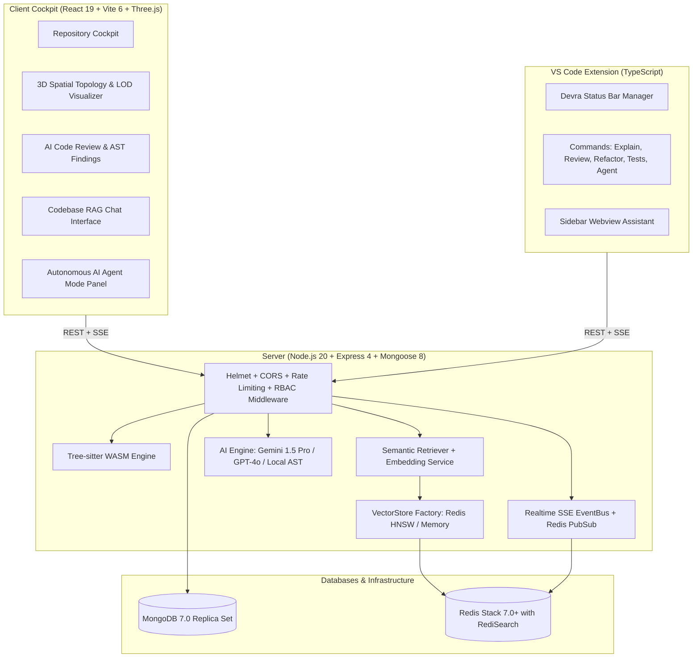

# DEVRA (DevPilot) — Production AI Developer Platform

DEVRA is an enterprise-grade AI developer platform uniting full-stack codebase intelligence, 3D interactive spatial dependency graphs with Level-of-Detail (LOD) optimization, automated AST code reviews, persistent vector RAG search, autonomous AI Agent workflows with live SSE streaming, and an editor-native VS Code extension.

---

## Table of Contents
1. [Key Capabilities](#key-capabilities)
2. [Technology Stack & Architecture](#technology-stack--architecture)
3. [Repository Structure](#repository-structure)
4. [Prerequisites & System Requirements](#prerequisites--system-requirements)
5. [Quickstart & Local Development](#quickstart--local-development)
6. [Environment Configuration Reference](#environment-configuration-reference)
7. [Authentication & Fine-Grained RBAC](#authentication--fine-grained-rbac)
8. [Persistent Vector Store & Semantic RAG](#persistent-vector-store--semantic-rag)
9. [Tree-sitter WASM AST Engine](#tree-sitter-wasm-ast-engine)
10. [Autonomous AI Agent Mode & Real-Time SSE](#autonomous-ai-agent-mode--real-time-sse)
11. [Three.js 3D Spatial Visualizer & LOD](#threejs-3d-spatial-visualizer--lod)
12. [GitHub Integration & Webhook PR Automation](#github-integration--webhook-pr-automation)
13. [VS Code Extension & Status Bar Integration](#vs-code-extension--status-bar-integration)
14. [Prometheus & OpenTelemetry Observability](#prometheus--opentelemetry-observability)
15. [Automated Testing Suite & Known Results](#automated-testing-suite--known-results)
16. [Production Deployment Guide](#production-deployment-guide)
17. [Pre-Launch Checklist & Security Hardening](#pre-launch-checklist--security-hardening)
18. [Health Checks, Troubleshooting, & Rollback](#health-checks-troubleshooting--rollback)
19. [REST API Reference (All 32 Endpoints)](#rest-api-reference-all-32-endpoints)
20. [License](#license)

---

## Key Capabilities

- **Codebase Analysis Engine**: Discovers architectural modules, package dependencies, entry points, and cyclomatic metrics across multi-language codebases.
- **3D Spatial Galaxy Visualizer**: High-performance Three.js WebGL graph clustering files by architectural domains (Frontend, Backend, Database, Services, Utilities) with 4-tier Level of Detail (LOD) rendering and single-draw-call instanced meshes.
- **AI-Powered Code Review**: Deep AST scanning identifying bugs, security vulnerabilities, performance bottlenecks, and code smells with line-specific suggestions and automatic quality scores.
- **Persistent Vector RAG Search**: Redis Stack HNSW vector indexing with cosine similarity search, repository/branch isolation, and fallback to in-memory vector storage.
- **Autonomous AI Agent Mode**: End-to-end development assistant: analyzes codebase &rarr; synthesizes step-by-step implementation plan &rarr; awaits user approval &rarr; generates unified diffs &rarr; provides safe, reversible file modifications with automated snapshots.
- **Real-Time SSE Streaming**: Server-Sent Events broadcasting live Agent Mode and code review progress over single-source or clustered Redis Pub/Sub backbones with automatic token redaction.
- **Fine-Grained RBAC**: Centralized authorization enforcing strict object-level ownership and role boundaries across `Admin`, `Architect`, `Developer`, and `Guest`.
- **Automated GitHub PR Webhooks**: Timing-safe HMAC-SHA256 signature verification, delivery deduplication, prompt-injection defense, and review-only PR comment automation.
- **VS Code Extension**: Native integration with command palette, diff preview editor (`vscode.diff`), interactive sidebar assistant, and a live persistent Status Bar.
- **Production Observability**: Prometheus metrics export (`/metrics`) with cardinality protection and route normalization, paired with non-intrusive OpenTelemetry distributed tracing and a Grafana dashboard.

---

## Technology Stack & Architecture



### Stack Breakdown
- **Frontend**: React 19, Vite 6, Tailwind CSS 3, Three.js 0.173, `@react-three/fiber` 9, `@react-three/drei` 10, Lucide Icons, Framer Motion.
- **Backend**: Node.js 20 LTS, Express 4.21, Mongoose 8.10, `ioredis` 6.0, `web-tree-sitter` 0.27, `jsonwebtoken`, `bcryptjs`, `helmet`, `express-rate-limit`, `prom-client` 15.1, `@opentelemetry/sdk-node`.
- **Databases**: MongoDB 7.0+ (MERN persistence), Redis Stack 7.0+ with RediSearch (persistent HNSW vector indexing & Pub/Sub event bus).
- **VS Code Extension**: TypeScript 5.7, VS Code API (`vscode.SecretStorage`, status bar items, diff providers).
- **Testing & Tooling**: Node test runner, Playwright 1.64 for E2E browser testing, Docker & Docker Compose, GitHub Actions.

---

## Repository Structure

```text
Devra/
├── .github/
│   └── workflows/ci.yml         # Automated CI/CD pipeline (backend, frontend, extension, e2e)
├── client/                      # React 19 + Vite frontend
│   ├── src/
│   │   ├── components/          # UI components, 3D visualizer, Agent panel, layout
│   │   ├── pages/               # Dashboard, Repositories, Review, Chat, Settings
│   │   └── services/api.js      # Axios client with JWT interceptor & SSE streams
│   ├── Dockerfile               # Multi-stage Nginx container
│   ├── nginx.conf               # SPA routing & caching configuration
│   └── vite.config.js           # Chunk code-splitting & manual chunks
├── server/                      # Express REST API backend
│   ├── src/
│   │   ├── config/              # Environment, MongoDB, and Redis connections
│   │   ├── controllers/         # Request handlers (auth, repo, review, chat, agent, webhook)
│   │   ├── metrics/             # Prometheus registry and OpenTelemetry SDK
│   │   ├── middleware/          # Auth, RBAC, error, metrics, and rate limiters
│   │   ├── models/              # Mongoose schemas (User, Repository, Review, Chat, AgentSession)
│   │   ├── routes/              # Express API routers mounted under /api/*
│   │   ├── services/            # Core domain logic (aiService, agentService, retriever, treeSitter)
│   │   └── utils/               # Structured logger, JWT helpers
│   ├── tests/                   # Automated unit & integration tests
│   ├── Dockerfile               # Production Node.js 20 Alpine container
│   └── test.js                  # Master backend test runner
├── extension/                   # VS Code extension (TypeScript)
│   ├── src/
│   │   ├── commands/            # Agent mode, code review, explanation, test generation
│   │   ├── services/            # StatusBarManager, ApiService, Diff preview provider
│   │   └── extension.ts         # Extension activation lifecycle
│   ├── package.json             # Commands, views, and configuration
│   └── tsconfig.json            # Extension TypeScript configuration
├── shared/                      # Monorepo shared constants, endpoints, and HTTP codes
├── docker/                      # Prometheus configuration (`prometheus.yml`)
├── grafana/                     # Grafana observability dashboards (`devra-observability.json`)
├── e2e/                         # Playwright E2E test suites and fixtures
├── docker-compose.yml           # Full-stack Docker orchestration
├── ecosystem.config.cjs         # PM2 cluster configuration
├── playwright.config.js         # Playwright test runner configuration
└── package.json                 # Monorepo workspaces and orchestration scripts
```

---

## Prerequisites & System Requirements

- **Node.js**: v20.x LTS or higher
- **npm**: v10.x or higher
- **MongoDB**: v6.0 or v7.0 (Local, Docker, or MongoDB Atlas replica set)
- **Redis Stack**: v7.0+ (with RediSearch module enabled; `redis/redis-stack-server:latest` or Redis Cloud)
- **Docker & Docker Compose**: Optional for containerized deployments
- **AI API Key**: Google Gemini (`AI_API_KEY`) or OpenAI Key (`OPENAI_API_KEY`)

---

## Quickstart & Local Development

### 1. Installation
Install all dependencies across monorepo workspaces (`client`, `server`, `extension`, `shared`):
```bash
npm run install:all
```

### 2. Environment Setup
Create local environment files from the provided templates:
```bash
cp .env.example .env
cp server/.env.example server/.env
cp client/.env.example client/.env
```
Ensure `server/.env` contains your `JWT_SECRET`, `AI_API_KEY`, `MONGODB_URI`, and `REDIS_HOST`.

### 3. Launch Development Environment
Run backend API and frontend client concurrently:
```bash
npm run dev
```

- **Web Cockpit**: [http://localhost:5173](http://localhost:5173)
- **API Server**: [http://localhost:5000](http://localhost:5000)
- **Health Heartbeat**: [http://localhost:5000/api/health](http://localhost:5000/api/health)
- **Readiness Probe**: [http://localhost:5000/api/health/ready](http://localhost:5000/api/health/ready)
- **Prometheus Metrics**: [http://localhost:5000/metrics](http://localhost:5000/metrics)

---

## Environment Configuration Reference

### Monorepo & Backend (`server/.env`)

| Variable | Required | Default | Description |
| :--- | :---: | :--- | :--- |
| `NODE_ENV` | Yes | `development` | Set to `production` in production environments |
| `PORT` | No | `5000` | Backend API port |
| `CLIENT_URL` | Yes | `http://localhost:5173` | Public URL of client web application (used for CORS) |
| `MONGODB_URI` | Yes | `mongodb://localhost:27017/devra` | MongoDB connection URI |
| `JWT_SECRET` | Yes | — | Cryptographically random secret string (min 32 bytes) |
| `JWT_EXPIRES_IN` | No | `7d` | Token expiration period |
| `REDIS_HOST` | No | `localhost` | Redis server hostname (`redis` in Docker Compose) |
| `REDIS_PORT` | No | `6379` | Redis server port |
| `REDIS_PASSWORD` | No | — | Optional password for Redis authentication |
| `REDIS_TLS` | No | `false` | Set to `true` when connecting over public networks |
| `VECTOR_STORE` | No | `redis` | Vector store backend: `redis` (production) or `memory` |
| `VECTOR_DIMENSION`| No | `128` | Embedding vector dimensions |
| `GITHUB_WEBHOOK_SECRET` | No | — | Secret for verifying GitHub PR webhook HMAC-SHA256 signatures |
| `METRICS_AUTH_TOKEN` | No | — | Optional Bearer token required to scrape `/metrics` |
| `OTEL_ENABLED` | No | `false` | Enable OpenTelemetry distributed tracing |
| `AI_PROVIDER` | No | `gemini` | AI Provider: `gemini` or `openai` |
| `AI_API_KEY` | Yes | — | API key for Gemini or OpenAI |
| `AI_MODEL` | No | `gemini-1.5-pro` | Model name: `gemini-1.5-pro` or `gpt-4o` |

---

## Authentication & Fine-Grained RBAC

DEVRA enforces four system roles with deny-by-default access policies and strict object-level ownership:

### Role Permissions Matrix

| Capability / Action | Permission Key | Admin | Architect | Developer | Guest |
| :--- | :--- | :---: | :---: | :---: | :---: |
| **Manage Users & Roles** | `user:manage` | Yes | No | No | No |
| **Delete Repository** | `repo:delete` | Yes | No | No | No |
| **Create Repository** | `repo:create` | Yes | Yes | Yes | No |
| **Read Repository** | `repo:read` | Yes | Yes | Yes | Yes |
| **Update Repository** | `repo:update` | Yes | Yes | Yes | No |
| **Sync Repository** | `repo:sync` | Yes | Yes | Yes | No |
| **Trigger Code Analysis** | `analysis:trigger` | Yes | Yes | No | No |
| **Read Code Analysis** | `analysis:read` | Yes | Yes | Yes | Yes |
| **Trigger Code Review** | `review:trigger` | Yes | Yes | No | No |
| **Read Code Review** | `review:read` | Yes | Yes | Yes | Yes |
| **Delete Code Review** | `review:delete` | Yes | Yes | No | No |
| **Chat / RAG Query** | `chat:send` | Yes | Yes | Yes | Yes |
| **Clear Chat History** | `chat:clear` | Yes | Yes | Yes | No |
| **Agent Mode (Plan/Apply)**| `agent:plan`, `agent:apply`| Yes | Yes | Yes | No |
| **SSE Event Stream** | `sse:stream` | Yes | Yes | Yes | Yes |

### Object-Level Access Control (OLAC)
- **Repository Access (`requireRepositoryAccess`)**: Non-owners are denied access to private repositories with HTTP 403, regardless of role permissions, unless they are a platform `admin` or the repository is explicitly public for read-only actions.
- **Agent Task Access (`requireTaskAccess`)**: Non-owners cannot inspect, stream, approve, or apply another user's Agent Mode task sessions.

---

## Persistent Vector Store & Semantic RAG

DEVRA features a decoupled vector store architecture behind an abstract `VectorStore` interface:
- **Redis Vector Store (`RedisVectorStore`)**: Uses Redis Stack with RediSearch (`FT.CREATE`, `FT.SEARCH`).
  - Index: `devra:idx:codebase`
  - Key Prefix: `devra:doc:{repositoryId}:{branch}:{chunkId}`
  - Algorithm: Hierarchical Navigable Small World (`HNSW`) with `COSINE` distance metric.
  - Tag Isolation: Strictly enforces `(@repositoryId:{...} @branch:{...})` on all KNN queries.
- **Memory Vector Store (`MemoryVectorStore`)**: Zero-dependency in-memory fallback for local development and offline CI runs.
- **Graceful Fallback**: `VectorStoreFactory` dynamically initializes Redis, falling back to Memory mode if Redis is offline without throwing unhandled exceptions.
- **Deterministic Chunks**: Code chunks receive stable IDs (e.g. `server/src/routes/authRoutes.js#L1-L42`). Re-indexing updates existing keys in place without duplicate vector accumulation.

---

## Tree-sitter WASM AST Engine

- **Grammar Support**: JavaScript, TypeScript, Python, Go, Rust, Java, C++, C, HTML, CSS, JSON.
- **Syntax Chunks**: `extractSyntaxChunks` parses structural declarations (functions, methods, classes, interfaces, types, imports, exports) into semantic chunks with line ranges.
- **Safeguards**:
  - Automatically filters binary files, lockfiles, and vendor directories (`node_modules`, `.git`, `dist`).
  - Files exceeding 500KB trigger safe line-window chunking fallbacks to prevent Node.js thread blocking.
  - Malformed syntax or incomplete code snippets are parsed safely without crashing the indexing process.

---

## Autonomous AI Agent Mode & Real-Time SSE

### Human-in-the-Loop Lifecycle
1. **Plan (`POST /api/agent/plan`)**: Agent inspects repository structure and synthesizes a step-by-step implementation plan (status: `plan_ready`).
2. **Approval (`POST /api/agent/:id/approve-plan`)**: User reviews the plan. The agent synthesizes unified diffs and validates safety rules (status: `changes_ready`).
3. **Apply (`POST /api/agent/:id/apply`)**: User confirms diffs. The agent captures an automated backup snapshot and safely applies modifications (status: `applied`).
4. **Reject (`POST /api/agent/:id/reject`)**: User discards proposed modifications. The repository remains completely untouched (status: `rejected`).

### Real-Time SSE EventBus
- Streams progress over `GET /api/agent/tasks/:taskId/events` using standard `text/event-stream`.
- Broadcasts multi-instance updates via Redis Pub/Sub channel `devra:events:task:{taskId}`.
- Emits keep-alive `heartbeat` events every 15 seconds.
- Automatically redacts sensitive passwords, JWT secrets, and API tokens from event payloads (`sanitizePayload`).

---

## Three.js 3D Spatial Visualizer & LOD

- **Galaxy Clustering**: Files are classified into 5 spatial domains (`Frontend`, `Backend`, `Database`, `Services`, `Utilities`) distributed across Fibonacci spheres.
- **Level of Detail (LOD) Strategy**:
  - **Level 0 (Overview, Distance > 22.0)**: Domain cluster hubs with aggregated inter-cluster dependency conduits.
  - **Level 1 (Module Detail, 12.0 < Distance ≤ 22.0)**: Core module entry points and primary cross-module API routes.
  - **Level 2 (File Detail, 5.0 < Distance ≤ 12.0)**: Complete repository file cloud rendered via `THREE.InstancedMesh` in a single draw call.
  - **Level 3 (Deep Inspection, Distance ≤ 5.0)**: Orbiting micro-AST symbols (functions, classes, interfaces) for inspected files.
- **Hysteresis Dead-Zone**: Transition threshold with a `0.8` unit guard band eliminates boundary flickering during camera zoom.
- **Eco Mode**: Monitored rolling frame rate automatically throttles background wireframes if FPS drops below 32, maintaining smooth interaction on low-power GPUs.

---

## GitHub Integration & Webhook PR Automation

- **Dedicated Webhook**: `POST /api/webhooks/github`
- **HMAC Verification**: Timing-safe HMAC-SHA256 signature verification (`crypto.timingSafeEqual`) computed on the exact raw request buffer (`req.rawBody`).
- **Deduplication**: `X-GitHub-Delivery` caching prevents duplicate execution on GitHub retry attempts.
- **Prompt Injection Defense**: Sanitizes PR titles and descriptions against system instruction overrides (`sanitizeUntrustedInput`).
- **Review Only**: Formats structured code reviews with AST findings. DEVRA will never automatically merge, approve, or push code.

---

## VS Code Extension & Status Bar Integration

- **Extension ID**: `devpilot-vscode`
- **Commands**:
  - `devpilot.connect`: Verifies backend connectivity and auth state.
  - `devpilot.setToken`: Securely stores JWT Bearer token in VS Code `context.secrets` keychain.
  - `devpilot.agentMode`: Launches the autonomous AI Agent panel.
  - `devpilot.reviewCode`: Performs inline AST code review.
  - `devpilot.explainCode`: Explains highlighted code blocks.
  - `devpilot.generateTests`: Synthesizes unit tests for selected functions.
  - `devpilot.openChat`: Opens sidebar codebase assistant.
- **Persistent Status Bar**:
  - `$(plug) DEVRA: Connect` (Disconnected)
  - `$(sync~spin) DEVRA: Connecting` (Establishing connection)
  - `$(check) DEVRA: Ready` (Ready for queries)
  - `$(lock) DEVRA: Sign In` (Auth token required)
  - `$(sync~spin) DEVRA: Agent Running [X%]` (Real-time task progress)
  - `$(check-all) DEVRA: Task Complete` (Completed)
  - `$(error) DEVRA: Task Failed` (Error state with sanitized message)

---

## Prometheus & OpenTelemetry Observability

### Prometheus Metrics (`/metrics`)
- **Route Normalization**: `normalizeRoute()` sanitizes dynamic ObjectIDs, UUIDs, and hashes into tokens (`:id`), preventing metric label explosion.
- **Endpoint Security**: Supports optional Bearer token authentication via `METRICS_AUTH_TOKEN`.
- **Key Metrics**:
  - `devra_http_requests_total`, `devra_http_request_duration_seconds`, `devra_http_in_flight_requests`
  - `devra_agent_tasks_total`, `devra_agent_task_duration_seconds`, `devra_agent_active_tasks`
  - `devra_rag_retrieval_total`, `devra_vector_store_operations_total`
  - `devra_treesitter_parse_operations_total`
  - `devra_sse_active_connections`, `devra_sse_events_emitted_total`
  - `devra_dependency_health_status` (`mongodb`, `redis`)

### OpenTelemetry Distributed Tracing
- Enabled via `OTEL_ENABLED=true`. Operates in non-intrusive no-op mode in test environments.
- Sanitizes trace span attributes to ensure no source code, tokens, or passwords are recorded.

---

## Automated Testing Suite & Known Results

### Test Execution Commands
```bash
# 1. Run backend unit, integration, and security test suite (72 tests)
npm test

# 2. Run VS Code extension unit tests (10 tests)
npm --prefix extension test

# 3. Compile VS Code extension TypeScript (0 errors)
npm run build:extension

# 4. Build client production assets with Vite
npm run build:client

# 5. Run Playwright End-to-End browser test suite
npm run test:e2e
```

### Verified Empirical Test Counts
- **Backend Unit & Integration Tests**: **72 passed, 0 failed, 0 skipped** across all 8 modules (RBAC negative authorization, Redis Vector Store, Realtime SSE, Tree-sitter WASM, PR Webhooks, Three.js LOD benchmarks, Observability).
- **VS Code Extension Tests**: **10 passed, 0 failed** (Status bar state machine, secret sanitization, task event scoping, disposal).
- **Extension TypeScript Compilation**: Succeeded with exit code 0 and 0 compiler errors.
- **Frontend Client Build**: Vite production build succeeded in 16.51s, outputting clean bundles in `client/dist/`.

---

## Production Deployment Guide

### Option 1: Docker Compose Orchestration (Recommended)
```bash
docker compose up -d --build
```
Orchestrates:
1. `devra-server`: Node.js 20 backend on port `5000`.
2. `devra-client`: Production Nginx serving built client on port `80`.
3. `devra-mongo`: MongoDB 7.0 database on port `27017`.
4. `devra-redis`: Redis Stack Server with RediSearch on port `6379`.

### Option 2: Bare Metal / VM Deployment (PM2 + Nginx)
```bash
# 1. Build client and compile extension
npm run build

# 2. Start backend cluster via PM2
pm2 start ecosystem.config.cjs
pm2 save
pm2 startup
```

Host Nginx reverse proxy configuration (`/etc/nginx/sites-available/devra.conf`):
```nginx
server {
    listen 80;
    server_name devra.yourdomain.com;

    # Client Static Assets
    location / {
        root /var/www/devra/client/dist;
        index index.html;
        try_files $uri $uri/ /index.html;
    }

    # API and SSE Proxy
    location /api/ {
        proxy_pass http://localhost:5000;
        proxy_http_version 1.1;
        proxy_set_header Upgrade $http_upgrade;
        proxy_set_header Connection 'upgrade';
        proxy_set_header Host $host;
        proxy_set_header X-Real-IP $remote_addr;
        proxy_set_header X-Forwarded-For $proxy_add_x_forwarded_for;
        proxy_set_header X-Forwarded-Proto $scheme;
        proxy_read_timeout 3600s;
        proxy_buffering off;
    }
}
```

---

## Pre-Launch Checklist & Security Hardening

Before deploying to staging or production infrastructure:

1. **Secrets & Rotation**:
   - [ ] Generate high-entropy 32+ byte string for `JWT_SECRET`.
   - [ ] Set unique `GITHUB_WEBHOOK_SECRET` matching your GitHub webhook settings.
   - [ ] Provide valid `AI_API_KEY` for Google Gemini or OpenAI.
   - [ ] Set `METRICS_AUTH_TOKEN` to prevent unauthorized scraping of `/metrics`.
2. **Infrastructure Verification**:
   - [ ] Confirm MongoDB replica set is running with TLS and authenticated users.
   - [ ] Confirm Redis Stack is running with RediSearch and persistent volume (`devpilot-redis-data`).
   - [ ] Verify `VECTOR_STORE=redis` in production environment.
3. **Security Safeguards**:
   - [ ] Confirm `CLIENT_URL` matches your public domain.
   - [ ] Verify negative authorization guards reject cross-user access to private repositories with HTTP 403.
   - [ ] Confirm webhook requests missing `X-Hub-Signature-256` are rejected with HTTP 401.
4. **Monitoring**:
   - [ ] Import `grafana/dashboards/devra-observability.json` into Grafana.
   - [ ] Configure Prometheus to scrape `/metrics` at 10-15s intervals.

---

## Health Checks, Troubleshooting, & Rollback

### Health & Readiness Endpoints
- **Liveness Probe**: `GET /api/health`
  Returns HTTP 200 with server status, uptime, and database connection state.
- **Readiness Probe**: `GET /api/health/ready`
  Checks MongoDB connection state and performs a bounded 1000ms vector store ping. Returns HTTP 200 (ready) or 503 (service unavailable).

### Troubleshooting Common Issues
- **`Redis unavailable / fallback warning`**: Ensure Redis Stack with the RediSearch module is running. If unconfigured, DEVRA falls back to `MemoryVectorStore`.
- **`Webhook 401 Unauthorized`**: Verify `GITHUB_WEBHOOK_SECRET` matches the secret configured in GitHub repository settings.
- **`SSE Connection Timeout`**: In reverse proxies (Nginx), ensure `proxy_read_timeout 3600s` and `proxy_buffering off` are set.

### Rollback Strategy
- Database backups: Ensure regular automated MongoDB dumps (`mongodump`).
- Agent snapshots: Agent Mode creates automatic pre-modification snapshots in MongoDB, allowing reversible file operations.
- Container rollback: Maintain tagged Docker images in your container registry to roll back image versions instantly (`docker compose down && docker compose up -d`).

---

## REST API Reference (All 32 Endpoints)

### System & Foundation
1. `GET /` — Service status, metadata, and links.
2. `GET /api/health` — Heartbeat, uptime, and MongoDB status.
3. `GET /api/health/ready` — Readiness probe checking database and vector store connectivity.
4. `GET /metrics` — Prometheus metrics export (supports Bearer token).

### Authentication & Users
5. `POST /api/auth/register` — Register user account.
6. `POST /api/auth/login` — User login; returns signed JWT.
7. `GET /api/auth/me` — Authenticated profile.
8. `POST /api/auth/logout` — Invalidate user session.
9. `GET /api/auth/users` — Admin list of all users.
10. `PATCH /api/auth/users/:id/role` — Admin update user role (`admin`, `architect`, `developer`, `guest`).

### Repositories & GitHub
11. `GET /api/repositories` — List user's connected repositories.
12. `POST /api/repositories` — Connect or create repository.
13. `GET /api/repositories/:id` — Get repository details, metrics, and AST file tree.
14. `PUT /api/repositories/:id` — Update repository metadata.
15. `DELETE /api/repositories/:id` — Delete repository and purge vector namespace.
16. `POST /api/repositories/:id/sync` — Trigger repository rescan and commit sync.
17. `GET /api/repositories/github/status` — GitHub OAuth connection status.
18. `GET /api/repositories/github/repos` — List available remote GitHub repositories.
19. `POST /api/repositories/github/connect-repo` — Import and link GitHub repository.
20. `POST /api/repositories/github/connect-account` — Link GitHub Personal Access Token.
21. `POST /api/repositories/github/disconnect` — Remove GitHub connection.

### Codebase Analysis & Reviews
22. `POST /api/analysis/:repositoryId` — Run full AST codebase analysis and complexity metrics.
23. `GET /api/analysis/:repositoryId` — Retrieve existing codebase analysis.
24. `POST /api/reviews/generate` — Generate AI code review with AST findings and suggestions.
25. `GET /api/reviews` — Paginated list of code reviews.
26. `GET /api/reviews/:id` — Get single code review details.
27. `DELETE /api/reviews/:id` — Delete code review.

### Codebase RAG Chat
28. `POST /api/chat/message` — Send message to RAG chat; returns grounded answer with line citations.
29. `GET /api/chat/history/:repositoryId` — Retrieve chat conversation history.
30. `DELETE /api/chat/history/:repositoryId` — Clear chat conversation history.

### Autonomous AI Agent Mode
31. `POST /api/agent/plan` — Create implementation plan for a specified goal.
32. `POST /api/agent/:id/approve-plan` — Approve plan and synthesize code diffs.
33. `POST /api/agent/:id/apply` — Safely apply proposed modifications with pre-backup snapshot.
34. `POST /api/agent/:id/reject` — Discard proposed modifications.
35. `GET /api/agent/:id` — Get agent session status, plan, diffs, and audit log.
36. `GET /api/agent` — List recent agent sessions.
37. `GET /api/agent/tasks/:taskId/events` — Real-time SSE progress stream.

### Webhooks
38. `POST /api/webhooks/github` — GitHub PR webhook ingestion with HMAC-SHA256 verification.

---

## License

This project is licensed under the [MIT License](LICENSE).
